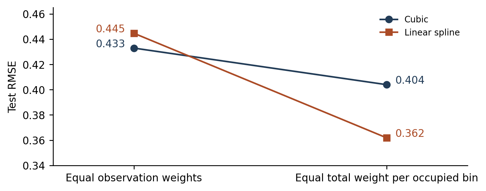

# Which analysis choices let a reader recover a materials result?

Two analysts can start with the same 236 copper measurements, fit the same models, and still disagree about which one predicts better. In one comparison here, the analysts even use the same 40 held-out observations and the same predictions. Changing the weight of those observations is enough to reverse the ranking.

**Vedant Thaker** · Research software and working paper  
[Read the paper (PDF)](manuscript.pdf) · [Read the editable manuscript](manuscript.md) · [Explore the 24 model comparisons](results.csv)

## The experiment

The input is the NIST Hahn1 copper thermal-expansion dataset. A cubic polynomial and a continuous, two-knot linear spline each fit four coefficients by least squares. Training observations alone determine coordinate scaling and knot locations. Replicates at the same temperature stay together when assigning a holdout.

Four choices define 24 complete specifications. The analysis crosses the eligible temperature range (all observations or at least 77 K), holdout (interleaved, interior gap or hot tail), coordinate (kelvin or log kelvin), and evaluation weights (per observation or equal total weight per occupied temperature bin). The fitted models are scored using held-out root-mean-square error (RMSE).

The archive experiment then hides each possible subset of those fields. A reader can recover the model choice when all compatible specifications name the same winner. Recovering the score pair also requires agreement on both RMSE values to eight decimal places.

## What the replay recovers

| Available information | Specifications with an identifiable winner | Specifications with an identifiable score pair |
| --- | ---: | ---: |
| No field assignments | 0 / 24 | 0 / 24 |
| Temperature range and coordinate | 12 / 24 | 0 / 24 |
| Temperature range, holdout and coordinate | 22 / 24 | 0 / 24 |
| All four fields | 24 / 24 | 24 / 24 |

The spline wins 15 comparisons and the cubic wins nine. The figure shows the two ambiguous specifications in the third row. With equal weight per observation, the cubic has lower RMSE (0.433 versus 0.445). With equal total weight per occupied temperature bin, the spline has lower RMSE (0.362 versus 0.404).



## Reproduce the result

Use Python 3.11. The numerical run used NumPy 1.26.0. From the repository root:

```bash
python -m pip install -r requirements.txt
python run.py
python verify.py
```

The verifier uses the Python standard library. It also runs directly against the committed outputs. It checks the NIST input checksum, recomputes all 16 archive-field comparisons from the primary rows, and checks the 40-observation model reversal. To rebuild the figure, run:

```bash
python -m pip install -r requirements-plot.txt
python make_figure.py
```

## Data and interpretation

- [Hahn1.dat](Hahn1.dat) preserves the input observations, certified coefficients and residual. [NIST dataset description](https://itl.nist.gov/div898/strd/nls/data/LINKS/i-hahn1.shtml)
- [manifest.json](manifest.json) records the input and analysis checksums, runtime, example prompt and field dictionary.
- [archives.csv](archives.csv) covers all 16 choices of fields to retain. [six_parameter_spline.csv](six_parameter_spline.csv) repeats the comparison with two extra spline knots.

The counts describe this finite specification grid. They do not measure human rerunner behavior or sample the distribution of choices a language model would make. The model comparison provides a way to test whether an archive preserves the evidence for a decision.
