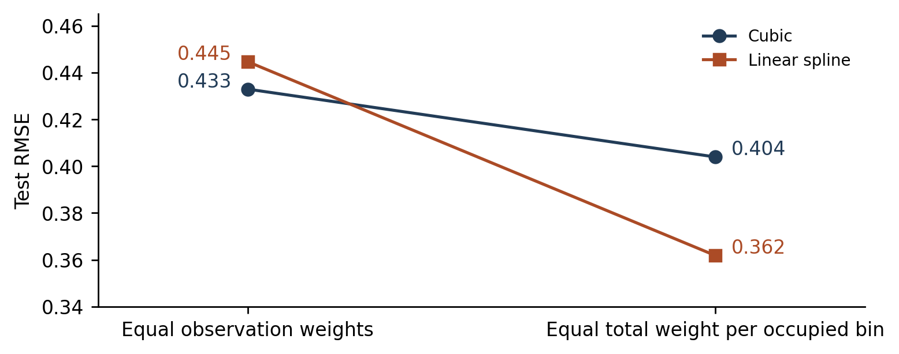

# Recovering model choices and scores from incomplete analysis records on three measured datasets

**Vedant Thaker**  
Independent Researcher, Jeffersonville, Indiana, United States  
Correspondence: vthaker1@asu.edu  
21 November 2026

## Abstract

A model name can survive a missing analysis decision even when its reported errors cannot. This study enumerates 24 cubic-versus-spline comparisons on each of three measured datasets: copper thermal expansion, automobile fuel consumption and abalone ring counts. For an incomplete record, the set of compatible executions defines a range of possible answers. When only evaluation weights were omitted, the winning model was determined for 22, 24 and 24 of the 24 specifications, respectively. The pair of root-mean-square errors (RMSEs) was uniquely determined in none of the 72 cases at eight-decimal precision. At a tolerance of 1% of the response standard deviation, acceptable pairs were guaranteed in 12, 4 and 0 cases. In a masked implementation pilot, two model-generated rerun functions each recovered 11 of 12 winners but only six exact error pairs, matching a fixed-default baseline. Archive quality therefore depends on the result a reader needs to recover and the acceptable numerical error.

## What an incomplete analysis record determines

A record that preserves the data and the words “compare the fits” leaves open which temperatures to hold back and how to score the errors. Those choices can alter the answer even when two analysts use exactly the same code and model families. Lei et al. discuss language models as a means of translating ambiguous materials-science requests into executable work [1]. Workflow Run RO-Crate represents inputs, outputs and actions at different levels of provenance detail [2]. Multiverse analysis exposes the consequences of alternative analytical decisions [3].

Treat a partial record as a constraint on a finite family of analytical choices. The empirical question is how often those choices agree on a winning model, how far the errors can differ, and how a plausible default performs when the record is ambiguous. Copper anchors a controlled reversal; the identical model and holdout menu is then tested on two further sources of measured data.

## Measured data and regression models

The NIST Hahn1 reference file contains 236 observations of the coefficient of thermal expansion of copper across 14.13–851.61 K, with 235 distinct temperatures [4]. The companion archive used a Ceres Solver copy [5]. A direct download from NIST had the same SHA-256 digest. Evaluating the seven-parameter rational curve with the coefficient values printed in the file gives a residual sum of squares of 1.53243828536, compared with NIST’s certified 1.5324382854. Two constants in the original program differ in their last digits from the printed coefficients. They were used solely to check the input. Neither regression below uses the rational curve.

Two models predict the held-out response in its original file units. The cubic uses the basis 1, z, z², z³. The continuous linear spline uses 1, z, max(0,z−k₁), max(0,z−k₂), with knots at the one-third and two-thirds quantiles of the training coordinate. Ordinary least squares estimates the four coefficients in each model. Both the transformation to z (subtract training mean and divide by training standard deviation) and the knot locations use only training rows. The spline extrapolates linearly outside its last segment. All fitted design matrices had full column rank.

## The 24 specifications

Four fields produce the full 2 × 3 × 2 × 2 grid. The temperature range includes all observations or temperatures at or above 77 K. The holdout is interleaved, a middle gap or the hot tail. Both repeated observations of any single temperature belong to the same fold. Index the n distinct temperatures in ascending order from zero. The interleaved fold uses ranks 2, 7, 12, and so on. The middle fold extends from floor(0.4n) through floor(0.6n)−1; the hot tail extends from floor(0.8n) through n−1. These rules specify information that the phrase “every fifth temperature” omits.

Both models use either kelvin or log kelvin for their coordinate. To score held-out predictions, row weighting gives every observation equal weight. Bin weighting divides the test temperatures in kelvin into five equal-width intervals, puts the rightmost endpoint in the final interval and assigns each occupied bin equal total weight. Each member of a bin receives the inverse of its bin’s sample size before normalization. Weighting affects the root-mean-square error (RMSE) only; it leaves the fitted coefficients and predictions untouched.

## A finite-set definition and a point-replay comparator

Let Ω denote the 24 full specifications, r a partial assignment and C(r) the nonempty set of specifications agreeing with r on every retained field. For specification s, write e(s) for the two RMSEs, in cubic–spline order, and w(s) for the lower-error model (ties go to the spline). The output identified by the record is the set of all (w(s), e(s)) with s in C(r). Winner identification requires all w(s) to agree.

Define the diameter of the error set as the larger of the two coordinate ranges (maximum minus minimum). This is the greatest pairwise difference under the maximum norm: every coordinate difference is bounded by its range, and the largest coordinate range is attained by two feasible specifications. A positive tolerance τ gives a directly checkable guarantee when the diameter is at most τ times the population standard deviation of y in the entire dataset. The standard deviation sets an error-reporting scale and never enters fitting. At τ=0 the reported exact criterion compares both RMSEs after rounding to eight decimal places.

The comparator fills unrecorded fields with all rows, interleaved ranks, the raw coordinate and equal row weights. Its single result can match the hidden choice while another compatible completion disagrees. For every subset of fields, each of the 24 specifications serves once as the hidden source. Counts are exhaustive over the declared menu. They have no interpretation as frequencies of real-world analytical habits. With all four fields recorded, unique recovery follows from the design. The informative comparisons concern omitted fields or tolerance changes. The original Hahn1 results below assume the same known code and menu for all records.

| Fields retained | Compatible | Winner | Score pair |
| --- | --- | --- | --- |
| None | 24 | 0 | 0 |
| Range, coordinate | 6 | 12 | 0 |
| Holdout, coordinate | 4 | 12 | 0 |
| Range, coord., weights | 3 | 15 | 0 |
| Range, holdout, coord. | 2 | 22 | 0 |
| All four | 1 | 24 | 24 |

Table 1. Selected subsets of recorded fields. Counts are numbers of source specifications out of 24. The full 16-subset table is included with the code.

## Hahn1: one set of residuals, two winners

The spline has lower RMSE in 15 of the 24 primary specifications, and the cubic in nine. Once range, holdout and coordinate are fixed, weights change the winner for only one pair. It comprises the same 40 interleaved observations at or above 77 K, fitted in kelvin. The data and residuals are identical under both weighting rules. With row weighting, densely sampled regions contribute more to mean square error. Equal-bin weighting lets each occupied interval contribute equally even when its sample size is small.

The hot-tail experiment instead changes the prediction problem. Using all temperatures, kelvin as coordinate and equal row weights, the hot-tail RMSEs are 23.928 for the cubic and 0.221 for the spline. On the interleaved fold those values are 1.030 and 0.617. The difference between extrapolating above the training range and predicting among training temperatures matters more here than the identity of the best model alone.

Figure 1. The same 40 held-out temperatures and fitted predictions change winners when the scoring weights change. The vertical quantity is RMSE in the response units of Hahn1.

## Sensitivity to knots and holdout phase

Adding two interior spline knots changes the model dimension from four coefficients to six and reverses three of the 24 primary decisions. An additional check varies which of the five possible zero-based rank offsets starts the interleaved split, keeping all other rules fixed. At offsets 1, 2, 3 and 4, the spline wins 15 of 24 and omitting weights leaves 22 winners identified. At offset 0, it wins 14, two interleaved groups have a weight-driven reversal and only 20 winners remain identified. Thus even counts of recoverable decisions can depend on a convention embedded inside a named field.

These are exhaustive comparisons for the listed alternatives. A sampling-based confidence interval on 15/24 would treat selected choices as random draws from an unspecified population. The complete field-ablation table, the offset sweep and the per-case errors instead show how the results vary over choices someone could actually implement.

## Transfer to fuel consumption and shell measurements

Auto MPG supplies displacement and city-cycle miles per gallon for 398 automobiles [6]. Abalone supplies shell length and ring count for 4,177 specimens [7]. Only the stated predictor and response were used. Auto MPG has missing horsepower values, a field unused here. Range thresholds on these two datasets use each dataset’s median observed predictor instead of the copper-specific 77 K cutoff. Duplicate x values stay in one fold, and every training design retains full rank. The same 24 branches, two models, 16 field subsets, and tolerance levels 0, 0.001, 0.01 and 0.05 were evaluated on each dataset.

Omitting only the weights allowed no exact score recovery in any dataset. At a 1%-of-SD tolerance, recoverable cases ranged from none for abalone to half of the copper grid. The original copper reversal was not universal. For both added datasets the winner survived every tested weight change, while the corresponding numbers could still move. When no fields were retained, no winner was identified on any dataset; the default nevertheless guessed 15, 12 and 18 of 24 winners correctly. This gap quantifies how misleading a point replay can be.

| Dataset | Winner | Exact pair | 1% SD | 5% SD | Default winner |
| --- | --- | --- | --- | --- | --- |
| Hahn1 | 22 | 0 | 12 | 20 | 23 |
| Auto MPG | 24 | 0 | 4 | 10 | 24 |
| Abalone | 24 | 0 | 0 | 8 | 24 |

Table 2. With only evaluation weights omitted, counts out of 24 source specifications. The score columns give guaranteed pairwise agreement of both RMSEs at the indicated tolerances. Full results include 0.1% SD.

## Masked code reconstruction on two unseen data assignments

A locally committed plan fixed the data, scoring and task generation before new outcomes were calculated. For each external dataset, six distinct source specifications were sampled with NumPy PCG64 seed 79139512. Each of three information levels (two, three or four retained fields) contributed two cases per dataset. The field subset for each case was also sampled. A coordinator supplied the same frozen prompt with anonymized case IDs and retained values to two separate model-assisted responders working in unrelated manuscript contexts. Responders received the algorithm dictionary and function signature. They did not see raw data, hidden assignments, numerical outputs or each other’s code, and did not execute the trial code before returning it. One had previously seen a Hahn1 headline in an unrelated review. Both were from the same model family; exact builds and sampling settings were not recorded.

Each responder supplied one Python/NumPy function. It selected a deterministic completion, returned a winner and two RMSEs, and flagged whether the winner agreed across compatible completions. The two functions were executed unchanged against held-back arrays, using frozen source assignments to score them. Each matched 11/12 winners, 6/12 exact score pairs, 6/12 pairs within 1% of response SD, and all 12 ambiguity flags. Both selected the first available option for missing values and matched the fixed-default comparator. Four of the 12 records documented all fields and should be read as implementation checks. Across the remaining eight incomplete cases both recovered seven winners and two score pairs.

Only one of the 12 selected records had an ambiguous winner. Both flagged it and guessed the incorrect hidden winner. Two different programs thus reproduced most model names without recovering many specific analysis choices. These are repeated runs of two returned programs on the same twelve records, not independent measures of 24 analysts. The pilot tests implementation from an unusually explicit dictionary and cannot estimate performance for other model families or independent human researchers.

| Fields supplied | Winner correct | Exact scores | Within 1% SD | Ambiguity correct |
| --- | --- | --- | --- | --- |
| 2 of 4 | 4/4 | 0/4 | 0/4 | 4/4 |
| 3 of 4 | 3/4 | 2/4 | 2/4 | 4/4 |
| 4 of 4 | 4/4 | 4/4 | 4/4 | 4/4 |

Table 3. Both unchanged model-generated functions produced the same scored counts. Each row has four records (two per external dataset).

## What belongs in a replayable comparison

The relevant minimum record depends on the question. If a reader only needs the better model on these data, the weights can often be omitted. If a reader must reconstruct both errors precisely, that omission mattered in every case tested. The five-offset check also shows why a split label needs an executable rank convention. Providing a matrix of alternative decisions with the source data and code makes these dependencies visible.

The grid specifies every admissible choice in advance. It omits alternative sampling units, model families, missingness treatments and error metrics. More varied tasks and blinded human reruns would test which conclusions survive outside this closed menu. Two model-produced functions with similar defaults cannot establish a general model- or human-reproducibility advantage.

## Data and code availability

The original Hahn1 code and archived runs are available in the baseline repository. The revision supplement bundles three verified inputs, all 72 branch-level comparisons, 192 dataset/subset/tolerance records, the exact masked prompt, both unmodified responder functions, hidden-assignment generator and scored trial. Run python recover.py and python score_blind.py. Earlier four-knot and phase checks are in previous_revision/.

[Pinned baseline](https://github.com/VEDANT1602/materials-workflow-replay/tree/4b7f708f6d655c7636ed23efc23563da03b01604) · [Revision code and data](https://github.com/VEDANT1602/materials-workflow-replay/tree/main/revision/supplement) · [Preparation record](https://github.com/VEDANT1602/materials-workflow-replay/blob/main/revision/PREPARATION.md)

## Computational verification

A separate implementation reproduced the original 24 primary and 24 four-knot Hahn1 fits within 1.1 × 10⁻¹³ RMSE. All 72 primary designs across the three datasets passed finite-data, positive-coordinate and full-rank checks. Two returned functions were scored against the preassigned records without outcome-based edits. This comparison verifies their behavior on these inputs only.

## Author contribution

Vedant Thaker is the sole author. He designed the original workflow replay study, wrote its manuscript, developed its original software, and requested the comparisons and checks reported in this revision.

## Use of computational assistance

OpenAI Codex assisted with the independent Hahn1 reconstruction, formalization and implementation of recovery metrics, additional public-dataset analyses, and masked generation, execution and scoring of two replay programs, as well as literature checks and preparation of the revised text. The author set the research question and requested the revision.

## Funding

This research received no specific grant from any funding agency in the public, commercial, or not-for-profit sectors.

## Competing interests

The author declares no competing interests.

## References

[1] G. Lei, R. Docherty and S. J. Cooper. Materials science in the era of large language models: a perspective. Digital Discovery 3, 1257–1272 (2024). https://doi.org/10.1039/D4DD00074A

[2] S. Leo et al. Recording provenance of workflow runs with RO-Crate. PLOS ONE 19(9), e0309210 (2024). https://doi.org/10.1371/journal.pone.0309210

[3] S. Steegen, F. Tuerlinckx, A. Gelman and W. Vanpaemel. Increasing transparency through a multiverse analysis. Perspectives on Psychological Science 11(5), 702–712 (2016). https://doi.org/10.1177/1745691616658637

[4] National Institute of Standards and Technology. Hahn1: thermal expansion of copper. Statistical Reference Datasets, nonlinear least squares, 236 observations. https://www.itl.nist.gov/div898/strd/nls/data/LINKS/i-hahn1.shtml

[5] Ceres Solver. Hahn1.dat (NIST/ITL StRD test fixture), data/nist, Git blob f3069d70abb3449eae006d330aa3f4a2506d1af4. https://ceres-solver.googlesource.com/ceres-solver/+/master/data/nist/Hahn1.dat

[6] R. Quinlan. Auto MPG [dataset]. UCI Machine Learning Repository (1993). https://doi.org/10.24432/C5859H

[7] W. Nash, T. Sellers, S. Talbot, A. Cawthorn and W. Ford. Abalone [dataset]. UCI Machine Learning Repository (1994). https://doi.org/10.24432/C55C7W
